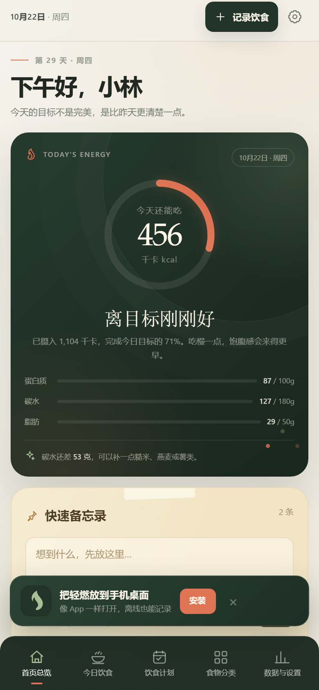

# 轻燃 · QINGRAN

一个只保存在本机的减脂饮食记录 App。包含手机 PWA 和 Windows 桌面版，不需要账号，不依赖云数据库。

**在线使用：https://lpp-li.github.io/qingran/**

## 手机上使用

- **Android**：Chrome 打开上面的地址 → 右上角「⋮」→「安装应用 / 添加到主屏幕」。
- **iPhone / iPad**：Safari 打开 → 底部「分享」→「添加到主屏幕」。
- 安装后可全屏打开，离线也能继续记录。
- 数据只保存在当前设备；Android 与 iPhone 之间不会自动同步。
- 建议定期在「数据与设置 → 数据管理」导出 JSON 备份。



## Windows 桌面版

双击 `启动轻燃.bat`，浏览器会自动打开 `http://127.0.0.1:47821/`。

桌面版内置本机 Node 服务，数据写入 `data/state.json`，每天自动保留一份备份。

## 功能

- **首页总览**：热量、营养素、三餐状态、快速备忘录、计划摘要、体重趋势、本周节奏。
- **今日饮食**：按餐次记录、食物搜索、份量换算、编辑删除、复制前一天。
- **饮食计划**：按目标生成三餐、换菜、调份量、锁定餐次、一键加入今日饮食。
- **食物分类**：8 个分类、标签筛选、营养详情、自建食物。
- **数据与设置**：体重/腰围、趋势图、目标进度、自动或手动营养目标、导入导出。
- **PWA**：可安装到主屏幕、离线缓存、本机存储。

## 本地开发

```powershell
# 桌面版（含本机数据文件）
.\启动轻燃.bat

# 仅静态预览 PWA
node server.js --no-open
```

打开：

- 桌面模式：`http://127.0.0.1:47821/`
- 强制 PWA 预览：`http://127.0.0.1:47821/?pwa=1`

代码全部是原生 HTML / CSS / JavaScript，不需要构建。

## 数据与隐私

- 手机版数据保存在浏览器/主屏幕 App 的本地存储中。
- 桌面版数据保存在本机 `data/state.json`。
- 隐私数据不会进入这个仓库；`.gitignore` 已排除 `data/`。
- 本项目不是医疗建议。内置营养值为常见参考值。
